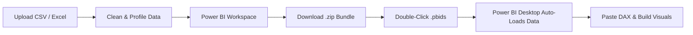

# 📊 Retail Intelligence & Sales Forecasting

[](https://www.python.org/)
[](https://streamlit.io/)
[](https://powerbi.microsoft.com/)
[](https://plotly.com/)
[](https://pytest.org/)
[](LICENSE)

An enterprise-grade, end-to-end analytics platform that transforms raw retail transaction records into automated data quality audits, statistical insights, multi-model sales forecasts, native Excel workbooks, executive PDF reports, and Microsoft Power BI Desktop integration packages.

---

## 🌟 Key Highlights

- **Dark Intelligence SaaS UI**: Inspired by modern fintech and enterprise analytics dashboards with midnight navy backgrounds (`#061321`), vibrant teal accents (`#19D9C5`), glowing KPI cards, and customized dark Plotly charts.
- **Dynamic Dataset Support**: Supports arbitrary CSV and Excel files. Dynamically infers column semantics (Revenue, Dates, Quantities, Profits, Categories, Regions, Customers, Identifiers) without hardcoded schemas.
- **Genuine Power BI Desktop Bridge**: Generates official `.pbids` data source connectors, typed Power Query (M) transformations, dynamic DAX measures, visual layout blueprints, and downloadable one-click ZIP packages.
- **Multi-Model Forecasting Suite**: Trains and compares ARIMA, Holt-Winters Exponential Smoothing, Seasonal Lag Baselines, and ML regressors with 95% confidence intervals and validation metrics (MAE, RMSE, MAPE).
- **Multi-Format Export Engine**: Exports native OpenPyXL workbooks with charts, ReportLab vector PDFs, and Power BI bundles.

---

## 🖥️ Application Modules & Navigation

```
MAIN MENU
  ├── 🏠 Overview               -> High-impact Executive Dashboard with live KPI cards, dual-axis trends & donut breakdowns
  ├── 📤 Data Upload             -> Multi-file CSV/Excel ingestion with drag-and-drop zone & built-in sample data loader
  ├── 📊 Data Understanding      -> Automated column profiling, memory footprints, missingness & data quality rules
  ├── 🧹 Data Cleaning           -> Audited imputation (mean/median/mode), IQR/Z-score outlier capping & whitespace/case normalization
  ├── 🔍 Exploratory Analysis    -> Descriptive stats, distribution interpretations, correlation matrices & statistical hypothesis tests
  ├── 💡 Business Insights       -> AI-assisted automated business findings with severity badges, evidence & recommended next steps
  ├── 📈 Forecasting             -> Automated date/target detection, multi-model training, error evaluation & future projections
  ├── 📑 Excel Report            -> Multi-sheet executive Excel BI workbook with native charts & formatted tables
  ├── 📊 Power BI Dashboard      -> Native .pbids connector, Power Query M-code, tailored DAX formulas & ZIP bundle
  └── 📄 PDF Report              -> Publication-ready executive analysis report in PDF format
```

---

## 🚀 Quick Start Guide

### 1. Prerequisites
- Python 3.11 or 3.12+
- Microsoft Power BI Desktop *(optional, for opening generated `.pbids` and DAX bundles)*

### 2. Clone Repository
```bash
git clone https://github.com/Tox-Ankit/Retail-Intelligence-Sales-Forecasting.git
cd Retail-Intelligence-Sales-Forecasting
```

### 3. Create & Activate Virtual Environment
```bash
# Windows (PowerShell)
python -m venv .venv
.\.venv\Scripts\Activate.ps1

# macOS / Linux
python3 -m venv .venv
source .venv/bin/activate
```

### 4. Install Dependencies
```bash
pip install --upgrade pip
pip install -r requirements.txt
```

### 5. Launch the Streamlit Application
```bash
streamlit run app.py
```
*The app will automatically open at `http://localhost:8501` in your default browser.*

---

## 📊 Microsoft Power BI Desktop Integration

The platform provides a streamlined bridge to Microsoft Power BI Desktop:



### Generated Power BI Artifacts:
1. **`prepared_dataset.csv`**: Normalized UTF-8 dataset with ISO-8601 timestamps and sanitized decimal precision.
2. **`power_bi_connection.pbids`**: Microsoft-standard connection file. Double-clicking immediately launches Power BI Desktop and pre-configures data ingestion.
3. **`power_query_transformations.m`**: Type-safe M language script for Power BI's Advanced Editor.
4. **`dax_measures.dax`**: Dynamic DAX business measures (`Total Revenue`, `Total Profit`, `Profit Margin %`, `Average Order Value`, `Revenue YTD`, `Customer Retention`).
5. **`dashboard_visual_guide.md`**: Step-by-step layout recipes mapping columns to Power BI visual wells (Cards, Clustered Bar Charts, Line Charts, Matrix Tables, Slicers).

---

## 🧪 Testing & Quality Assurance

The codebase includes 289 automated unit and integration tests covering the ingestion pipeline, data cleaning, statistical tests, machine learning models, reporting engines, Power BI generators, and UI themes:

```bash
# Run the complete test suite
pytest

# Run tests with verbose output
pytest -v

# Run with coverage report
pytest --cov=src
```

```
============================ 289 passed in 12.66s =============================
```

---

## 📁 Repository Structure

```
Retail-Intelligence-Sales-Forecasting/
├── app.py                     # Main Streamlit application entry point
├── requirements.txt           # Python dependencies
├── README.md                  # Project documentation
├── .gitignore                 # Version control exclusion rules
├── config/                    # Global configurations & paths
├── data/                      # Local data directory
├── models/                    # Model checkpoints & cache
├── reports/                   # Generated reports directory
├── src/
│   ├── analytics/             # Descriptive statistics, distributions, correlations & tests
│   ├── cleaning/              # Missing value imputation, outliers, duplicates & normalization
│   ├── forecasting/           # Time series & ML forecasting engine, evaluation & detection
│   ├── ingestion/             # Multi-format CSV/Excel loaders and Dataset models
│   ├── insights/              # Automated business insight generation engine
│   ├── machine_learning/      # Scikit-learn & regression training pipelines
│   ├── profiling/             # Structural column profiler & key detection
│   ├── quality/               # Data quality rules & anomaly detection
│   ├── reporting/
│   │   ├── excel_report.py    # Native OpenPyXL workbook builder with charts
│   │   ├── pdf_report.py      # ReportLab PDF generator
│   │   └── powerbi/           # Power BI semantic detector, DAX generator & PBIDS packager
│   └── ui/
│       ├── theme.py           # Dark Intelligence CSS design system & Plotly dark templates
│       ├── overview.py        # Executive Overview dashboard
│       └── pages.py           # Modular page renderers
└── tests/                     # 289 comprehensive unit and integration tests
```

---

## 🛡️ Data Privacy & Architecture Guarantees

- **No Permanent Cloud Storage**: Uploaded files are processed in-memory and in isolated temporary session directories.
- **Zero Authentication Overhead**: Built for local enterprise workstations and personal analyst environments without login hurdles.
- **Deterministic & Non-Destructive**: Cleaning operations produce audited transforms without mutating source data.

---

## 📄 License

This project is licensed under the [MIT License](LICENSE).
